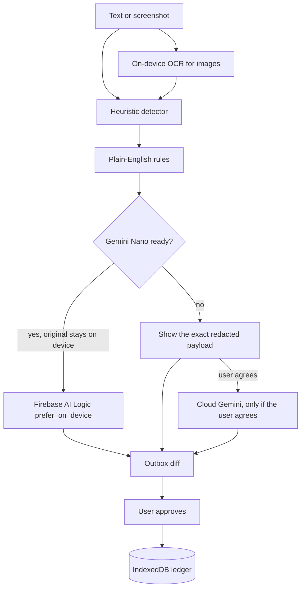
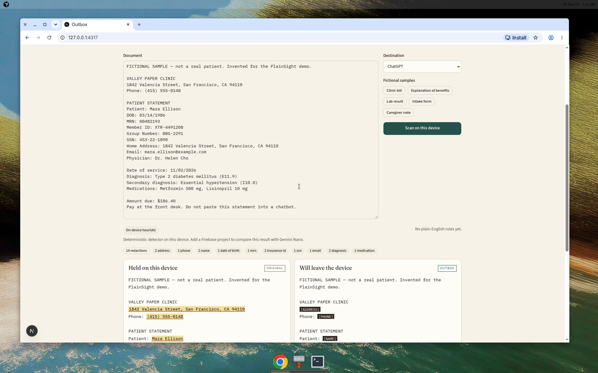
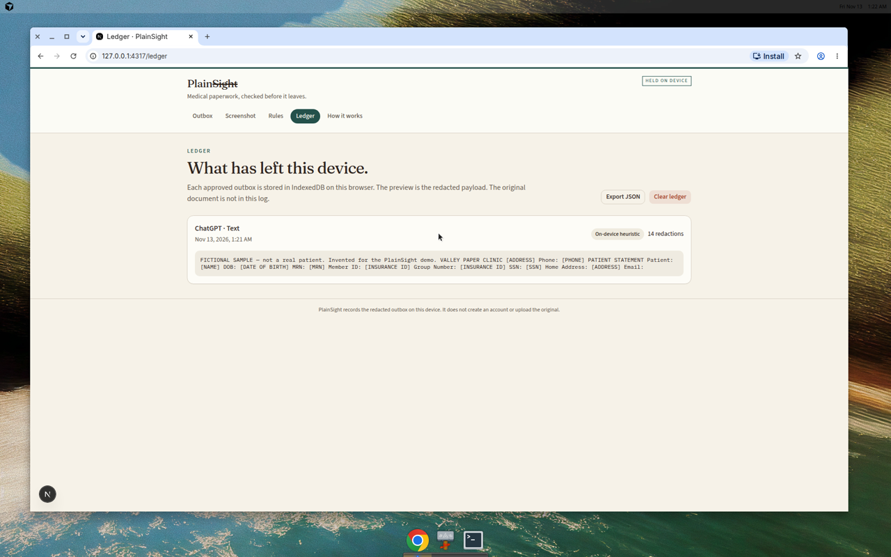
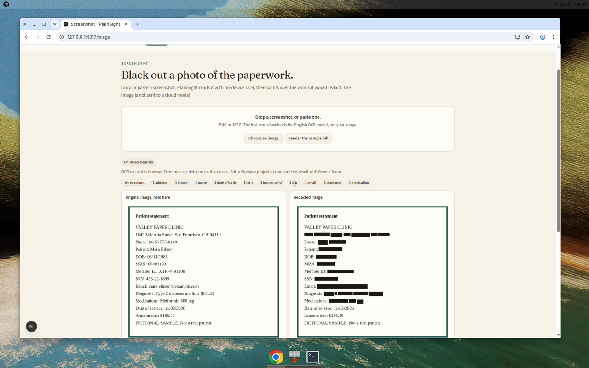
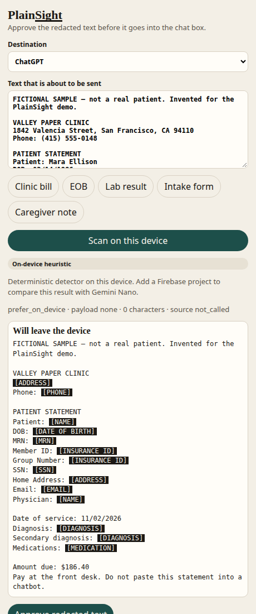

# PlainSight

**Live demo:** [https://plainsight-hybridai.vercel.app](https://plainsight-hybridai.vercel.app)

PlainSight is a privacy layer that runs before medical paperwork leaves a device. Patients, caregivers, and front-desk staff paste bills, explanations of benefits, lab results, and intake forms into AI chatbots. PlainSight marks the personal and medical details first, shows the exact text that would be sent, and waits for an approval.

The original stays on the device until that approval. The local ledger records the redacted payload, not the source document.

## Problem

A clinic bill is a small document with a large amount of identifying data: a name, a date of birth, a medical record number, a member ID, an address, a diagnosis, a medication. Pasting it into ChatGPT, Gemini, or Claude sends all of that to someone else’s servers, and the person at the keyboard rarely sees a precise account of what went out.

Browser guards that block a whole site, or demos that only classify a string as “sensitive,” still leave the sender guessing. PlainSight is the missing pause: a diff, a decision, and a record.

## What it does

1. **Outbox.** The original and the redacted copy sit side by side. Every removal is highlighted. Approving copies the redacted text and writes the ledger. Editing the document after a scan invalidates that approval.
2. **Ledger.** IndexedDB stores the time, destination, redaction counts, inference path, and a short preview of the redacted payload. The log can be exported as JSON or cleared. The original is not stored.
3. **Rules in plain English.** “never send my kid's name Maya Chen” becomes a literal redaction. “keep insurance IDs, hide everything else” leaves member IDs visible. The sentence is parsed on the device. If Gemini Nano is ready, Firebase AI Logic may refine the structure on-device. Rule text is not sent to the cloud, because the rule itself can contain a name.
4. **Screenshots.** Paste, drop, or render a sample bill. [Tesseract.js](https://github.com/naptha/tesseract.js) reads the image in the browser. PlainSight paints black bars over the words it would redact. The image bytes are not uploaded. The English OCR model may download on first use; that download is the engine, not the picture.
5. **Web app and Chrome extension.** The web app is also an installable PWA. The extension (Manifest V3) adds a side panel and a content script on chatgpt.com, gemini.google.com, claude.ai, and generic text fields. A context-menu item redacts a selection on other pages.

A deterministic detector always runs first, so the demo still works when Gemini Nano is unavailable. It covers labeled names, dates of birth, MRNs, insurance and group IDs, street addresses, phone numbers, SSNs, email addresses, diagnosis lines (including ICD-10 codes), and a list of common medications. Names that only appear in a sentence are left alone until a rule or an on-device model catches them. That gap is intentional: it is why the plain-English rule exists.

## Architecture



Detection prefers the device. `getGenerativeModel` is created with `InferenceMode.PREFER_ON_DEVICE` (`"prefer_on_device"`). PlainSight still chooses the payload before the call:

- If Chrome reports the on-device model as available, the prompt may contain the original. The response `inferenceSource` must be `on_device`. If the SDK reports `in_cloud` anyway, model suggestions are discarded and the badge says the cloud ran.
- If Nano is not ready, no model is called. The outbox shows the heuristic result and the exact redacted string a cloud call would use. The cloud request is a separate button. `assertCloudPayloadIsRedacted` refuses a cloud prompt that still contains the raw document.
- Screenshot pixels never go to Firebase. Only OCR text can reach a model, and only under the same rules.

Firebase App Check is initialized before AI Logic, with reCAPTCHA Enterprise on the web. Android, if you add it later, would use Play Integrity. See below.

## Screenshots

These stills are from the local app and the extension side panel, using only the fictional samples. They are not real patients. The browser frame is included on the web shots.










## Run the web app

```bash
npm install
npm run dev
```

Open [http://127.0.0.1:4317](http://127.0.0.1:4317). Load a fictional sample, scan, and approve. The app works with no Firebase project: the badge reads **On-device heuristic**.

Production build:

```bash
npm run build
npm start
```

The PWA manifest is served by Next.js. `public/sw.js` is a network-only worker so documents are not written into the Cache API. On a phone-width browser, use the install prompt to add PlainSight to the home screen.

### Android

This repo does not ship a Kotlin app. A native build needs Android Studio, a Firebase Android app, Play Integrity, and a device with Gemini Nano through AICore / ML Kit. The responsive PWA is the mobile surface you can try here.

When you add Android, keep the same rule the web app uses: `InferenceMode.PREFER_ON_DEVICE` via Firebase AI Logic (`firebase-ai` plus `firebase-ai-ondevice`), and send the cloud model only text that has already been redacted. Sketch:

```kotlin
val model = Firebase.ai(backend = GenerativeBackend.googleAI())
    .generativeModel(
        modelName = "gemini-3.5-flash-lite",
        onDeviceConfig = OnDeviceConfig(mode = InferenceMode.PREFER_ON_DEVICE),
    )
```

App Check on that app should use Play Integrity, with the debug provider only on debug builds. Confirm the current method names against [Firebase AI Logic for Android](https://firebase.google.com/docs/ai-logic/hybrid/android/get-started) before you depend on them. The on-device SDK is still experimental.

## Firebase and App Check

Copy `.env.example` to `.env.local`. Leave the values empty to stay on the heuristic detector. To turn on hybrid inference:

1. Create or open Mark’s Firebase project. In the console, go to **AI Services → AI Logic** and finish **Get started**. Choose the Gemini Developer API. The guided setup enforces App Check for Firebase AI Logic. If the APIs tab still says **Unenforced** for Firebase AI Logic, enforce it.
2. Register a web app and copy the config into `.env.local` (`NEXT_PUBLIC_FIREBASE_API_KEY`, auth domain, project id, storage bucket, messaging sender id, app id).
3. Create a score-based reCAPTCHA Enterprise key and register it as the App Check provider for that web app. Put the site key in `NEXT_PUBLIC_RECAPTCHA_ENTERPRISE_SITE_KEY`. Do not add `localhost` to a key you will ship.
4. For local development, set `NEXT_PUBLIC_APPCHECK_DEBUG=true`. Reload the app, copy the debug token from the browser console, and register it under **App Check → Apps → Manage debug tokens**. Do not commit the token, and do not leave debug mode on in a production build.
5. Optional: set `NEXT_PUBLIC_FIREBASE_CLOUD_MODEL`. The SDK default cloud model is `gemini-3.5-flash-lite`. PlainSight passes that name through `inCloudParams` unless you override it.
6. Rebuild the extension after changing env vars (`npm run build:extension`) so the side panel picks up the same public config.

The web client initializes Firebase in this order: `initializeApp`, `initializeAppCheck` with `ReCaptchaEnterpriseProvider`, `getAI` with `GoogleAIBackend`, then:

```ts
getGenerativeModel(ai, {
  mode: InferenceMode.PREFER_ON_DEVICE,
  inCloudParams: { model: cloudModel },
});
```

`initializeDeviceModel()` runs from the scan button, which is a user gesture, before `generateContent()`. Chrome 139+ on desktop can use Gemini Nano. The model download can take several minutes the first time. Until `LanguageModel.availability()` reports `available`, PlainSight will not put the original document in a prompt.

The badge after a scan is one of:

- **On-device heuristic** — no model call
- **On-device · Gemini Nano** — `inferenceSource` was `on_device`
- **Cloud fallback · redacted text only** — the user sent the redacted payload, or a Nano call unexpectedly fell through to the cloud

## Load the extension

```bash
npm run build:extension
```

In Chrome, open `chrome://extensions`, enable Developer mode, and choose **Load unpacked**. Select `extension/dist`.

- The toolbar icon opens the side panel.
- On ChatGPT, Gemini, Claude, and other pages, focus a text field. **Check with PlainSight** sends that text to the side panel.
- Select text anywhere and use the context menu **Redact selection with PlainSight**.
- **Approve redacted text** writes the extension’s own IndexedDB ledger and, when the field is still available, replaces the composer. The extension origin and the web app origin do not share a ledger. That is deliberate: nothing is synced to a server.

The content script matches the AI hosts and generic `http`/`https` pages so ordinary textareas get the same check. Review that host list before you publish the extension.

## Samples

`samples/` holds fictional paperwork. Each file starts with `FICTIONAL SAMPLE — not a real patient.` Names, numbers, and clinical facts were invented. The web app loads them from `/samples/…`. Do not replace them with real records.

## Test plan

Unit tests cover the detector, the rule parser, cloud-payload refusal, scan orchestration, the ledger preview, and OCR word mapping.

```bash
npm test
npm run lint
npm run build
npm run build:extension
```

What the tests lock in:

- A clinic bill loses the name, DOB, MRN, member ID, group number, SSN, address, email, phone, physician, diagnosis, and medications. The service date and the dollar amount stay.
- An EOB keeps the service date and the claim number. Those are not treated as a birth date or a member ID.
- “Maya Chen” in the caregiver note survives the heuristic pass and disappears after `never send my kid's name Maya Chen`.
- `keep insurance IDs, hide everything else` preserves member and group IDs and still redacts the SSN.
- A cloud prompt’s document section is the redacted text. A prompt that still carries the raw document throws.
- With Firebase configured and Nano unavailable, `runScan` does not call the model until `allowCloud` is true.
- A cloud finding that names an already-redacted SSN is dropped. A leftover name that is still in the redacted text can be added.
- If a call that was supposed to stay on device reports `in_cloud`, model suggestions are discarded.
- A ledger entry’s JSON does not contain the original sentence.

Manual pass before a recording:

1. Load the clinic bill, scan, and read both columns. Approve. Open the ledger and confirm the preview has tokens such as `[SSN]`, not the number.
2. Export the JSON. Clear the ledger and confirm the empty state returns.
3. Open the caregiver note. Confirm Maya Chen is still visible. Save the kid’s-name rule. Scan again and confirm the name is `[NAME]`.
4. On the screenshot page, render the sample bill. Confirm black bars and that the service date is still readable if OCR kept it.
5. With Firebase configured, scan once in Chrome 139+ after Nano has downloaded. The badge should say Gemini Nano, and the network panel should not show the raw SSN. Then try a browser without Nano, decline the cloud button, and confirm no AI Logic request left the machine. Accept the cloud button only after reading the payload preview.
6. Load the extension, focus a textarea, and replace it from the side panel.

CI is `.github/workflows/ci.yml`. It runs the test, lint, Next.js build, and extension build on Node 22.

## Project layout

- `src/lib/phi/` — detector, rules, hybrid prompt guard, scan orchestration, ledger
- `src/lib/firebase/` — App Check and `prefer_on_device`
- `src/lib/image/` — OCR and canvas redaction
- `src/app/` — web app and PWA manifest
- `extension/` — Manifest V3 source; `extension/dist` is the unpacked build
- `samples/` — fictional documents

## Deploy

The site is a static-friendly Next.js app. [Deploy to Netlify](https://app.netlify.com/start/deploy?repository=https://github.com/LevelUpWorldHub/plainsight) uses `netlify.toml`: Node 22, `npm run build`, publish `.next`. Netlify installs the Next.js runtime. Leave the Firebase environment variables empty to ship the on-device heuristic. Set the `NEXT_PUBLIC_*` values from `.env.example` in the Netlify UI when Mark’s project is ready. Do not mark `NEXT_PUBLIC_APPCHECK_DEBUG` true on that site.

The extension is not part of the website deploy. Build it with `npm run build:extension` and load `extension/dist` unpacked.

A production Lighthouse run of the home page (mobile) scored 98 performance, 100 accessibility, 100 best practices, and 100 SEO.

## Built for #BuildHybridAI

PlainSight is an entry for Google’s #BuildHybridAI hackathon on Devpost. Judging closes after submissions; the deadline for this entry is Monday, November 30, 2026 at 2:00 PM PT.

Every model call goes through Firebase AI Logic in hybrid mode. On-device Gemini Nano is the path that may see an original document. The cloud path is opt-in and receives text that the local detector has already redacted. App Check is wired for reCAPTCHA Enterprise, with Play Integrity called out for a future Android app. The product is aimed at a real workflow: a person holding a medical document and deciding, in view of a diff, what an AI tool is allowed to see.

Draft Devpost answers live in `SUBMISSION.md`. A three-minute recording script lives in `DEMO_SCRIPT.md`. Do not publish real Firebase keys with either.

## License

Apache License 2.0. Copyright 2026 LevelUpWorldHub. See `LICENSE`.
